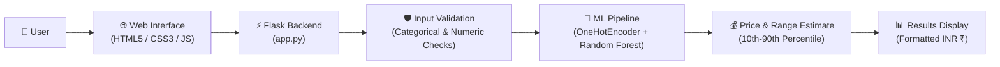

<div align="center">

# 💻 Laptop Price Predictor

<p><strong>Predict laptop prices in INR using Machine Learning and Flask.</strong></p>

[](https://www.python.org/)
[](https://flask.palletsprojects.com/)
[](https://scikit-learn.org/)
[](https://scikit-learn.org/stable/modules/generated/sklearn.ensemble.RandomForestRegressor.html)
[](https://docs.pytest.org/)
[](https://www.docker.com/)

<p>
  <a href="#-project-overview">Overview</a> •
  <a href="#-features">Features</a> •
  <a href="#-technology-stack">Tech Stack</a> •
  <a href="#-architecture--workflow">Architecture</a> •
  <a href="#-installation--execution">Getting Started</a> •
  <a href="#-api-documentation">API Docs</a> •
  <a href="#-automated-testing">Testing</a> •
  <a href="#-docker-deployment">Docker</a> •
  <a href="#-portfolio-presentation">Portfolio</a>
</p>

</div>

---

## 📋 Table of Contents

- [Project Overview](#-project-overview)
- [Features](#-features)
- [Technology Stack](#-technology-stack)
- [Architecture & Workflow](#-architecture--workflow)
- [Project Structure](#-project-structure)
- [Installation & Execution](#-installation--execution)
- [API Documentation](#-api-documentation)
- [Automated Testing](#-automated-testing)
- [Docker Deployment](#-docker-deployment)
- [Screenshots](#-screenshots)
- [Portfolio Presentation](#-portfolio-presentation)
- [Limitations & Future Scope](#-limitations--future-scope)

---

## 📖 Project Overview

**Laptop Price Predictor** is a full-stack machine learning web application that estimates laptop market prices in Indian Rupees (₹ INR) based on configurable hardware specifications. The backend uses a trained scikit-learn **Random Forest Regressor** pipeline encapsulated in a **Flask** web service, coupled with a responsive, modern frontend interface.

The application delivers:
- **Predicted Laptop Price:** Estimated market price in INR, rounded to the nearest hundred.
- **Estimated Price Range:** A likely price interval computed from the 10th to 90th percentile predictions across individual trees in the Random Forest ensemble.
- **Interactive Web Interface:** A user-friendly form with dynamic dropdowns and real-time client-side calculation.
- **Input Validation:** Strict server-side schema and numerical boundary checks.
- **REST API Endpoints:** Clean JSON endpoints for programmatic prediction and specification options.

> [!IMPORTANT]
> **Dataset Disclosure:** The current training dataset is **synthetically generated** in `train_model.py` (3,000 samples) using hardware pricing formulas and Gaussian noise. It demonstrates an end-to-end machine learning engineering pipeline (feature encoding, target transformation, uncertainty estimation, and web serving) rather than verified real-world retail market prices. To train on live market data, replace `build_dataset()` in `train_model.py` with `pd.read_csv("your_data.csv")` using identical column names.

---

## ✨ Features

- 🏷️ **Brand Selection:** Options for major laptop manufacturers (Acer, Apple, Asus, Dell, HP, Lenovo, MSI).
- ⚡ **Processor Selection:** Multi-tier CPU options including Intel Core (i3, i5, i7, i9), AMD Ryzen (3, 5, 7, 9), and Apple Silicon (M1, M2, M3).
- 💾 **RAM & Storage Configuration:** RAM options from 4 GB up to 64 GB; SSD and HDD storage configurations from 256 GB to 2048 GB.
- 🎮 **GPU Selection:** Graphics options ranging from Integrated GPUs to dedicated NVIDIA RTX series (GTX 1650, RTX 3050, RTX 4060, RTX 4070) and AMD Radeon.
- 📏 **Screen Size & Weight:** Configurable display sizes (13.3" to 17.3") and adjustable laptop weights (0.5 kg to 5.0 kg).
- 🖥️ **Operating System Selection:** Support for Windows 11, macOS, Linux, and DOS.
- 👆 **Touchscreen Configuration:** Toggle for touchscreen capability.
- 💰 **Price Prediction in INR:** Model prediction computed in rupees with localized formatting.
- 📈 **Estimated Prediction Range:** 10th to 90th percentile interval across individual ensemble trees to quantify price variation.
- 🎨 **Responsive Frontend & Themes:** Clean CSS Grid layout with mobile responsiveness and automatic Dark Mode support via `prefers-color-scheme`.
- 🔌 **Flask REST API:** Dedicated endpoints (`/health`, `/api/options`, `/predict`) with JSON payloads and error handling.
- 🧪 **Automated Tests:** Comprehensive unit test suite covering health checks, UI rendering, input validation, and inference sanity.
- 🐳 **Docker Support:** Production-ready containerization with Gunicorn WSGI server, healthchecks, and non-root security.

---

## 🛠️ Technology Stack

| Category | Technologies | Description |
|---|---|---|
| **Backend** | Python, Flask, Gunicorn | Lightweight web framework, routing, JSON API, and WSGI HTTP server |
| **Machine Learning** | Scikit-learn, Random Forest Regressor | Ensemble regressor (150 trees) with `TransformedTargetRegressor` |
| **Data Processing** | Pandas, NumPy | Data structures, feature generation, array math, and log-scaling |
| **Model Persistence** | Joblib | Serialization and compression of trained pipeline and option mappings |
| **Frontend** | HTML, CSS, JavaScript | Semantic HTML5, responsive CSS Grid, CSS custom properties, Fetch API |
| **Testing** | Pytest | Test runner validating endpoints, input validation, and model behavior |
| **Deployment Support** | Docker | Containerized packaging for cross-platform deployment |

---

## 🏗️ Architecture & Workflow

The following flowchart outlines the end-to-end request and prediction lifecycle:



---

## 📁 Project Structure

```text
├── app.py              # Flask backend (web interface & JSON REST API)
├── train_model.py      # Dataset generation, pipeline definition, model training
├── model.pkl           # Serialized model pipeline, metrics, and options bundle
├── requirements.txt    # Project dependencies for runtime and testing
├── Dockerfile          # Production Docker container definition with Gunicorn
├── README.md           # Project documentation and guide
├── .gitignore          # Git ignore rules for caches, virtual environments, and secrets
├── templates/
│   └── index.html      # Frontend HTML template with asynchronous Fetch UI script
├── static/
│   └── style.css       # Responsive styling with light and dark mode variables
└── tests/
    └── test_app.py     # Pytest test suite for routes, validation, and predictions
```

---

## 🚀 Installation & Execution

Follow these step-by-step Windows PowerShell commands to set up and run the application locally:

### 1. Clone the Repository
```powershell
git clone https://github.com/nareshbabuyadav69/Mlops-project.git
cd Mlops-project
```

### 2. Create and Activate a Virtual Environment
```powershell
python -m venv .venv
.\.venv\Scripts\Activate.ps1
```

### 3. Install Dependencies
```powershell
python -m pip install -r requirements.txt
```

### 4. (Optional) Retrain the Model
A pre-trained `model.pkl` is already included. You only need to run this command if `model.pkl` is missing or if you want to regenerate the synthetic dataset and retrain:
```powershell
python train_model.py
```
*Expected training output:*
```text
Test metrics: {'r2': 0.9401, 'mae_inr': 5039.86, 'train_rows': 2400, 'test_rows': 600}
Saved model to ...\model.pkl (4.4 MB)
```

### 5. Start the Flask Application
```powershell
python app.py
```

Once started, open your web browser and navigate to:
```text
http://127.0.0.1:5000
```

---

## 📡 API Documentation

The application exposes a clean RESTful interface alongside the web UI.

### Endpoints Overview

| Method | Endpoint | Description |
|---|---|---|
| `GET` | `/` | Renders the web application interface |
| `GET` | `/health` | Health check endpoint returning `{"status": "ok"}` |
| `GET` | `/api/options` | Returns available options for dropdown specifications |
| `POST` | `/predict` | Predicts laptop price and price range from JSON specifications |

---

### Prediction Endpoint (`POST /predict`)

**Headers:**
```http
Content-Type: application/json
```

**Example Request:**
```json
{
  "brand": "Dell",
  "processor": "Intel Core i5",
  "ram_gb": 16,
  "storage_type": "SSD",
  "storage_gb": 512,
  "gpu": "Integrated",
  "screen_size": 15.6,
  "weight_kg": 1.8,
  "os": "Windows 11",
  "touchscreen": 0
}
```

**Example Response (`200 OK`):**
```json
{
  "currency": "INR",
  "price": 45600.0,
  "low": 43000.0,
  "high": 49000.0
}
```

**Validation Error Response (`400 Bad Request`):**
```json
{
  "error": "Invalid or missing 'brand'. Choose one of: Acer, Apple, Asus, Dell, HP, Lenovo, MSI"
}
```

**HTTP Status Codes:**
- `200 OK`: Request was valid and prediction computed successfully.
- `400 Bad Request`: Missing field, non-JSON body, unlisted categorical option, or numeric value out of bounds.

---

## 🧪 Automated Testing

The project includes an automated test suite implemented in `tests/test_app.py` using **Pytest**.

### Run Tests
```powershell
python -m pytest tests -v
```

### What the Tests Verify
- **Health check:** Verifies `GET /health` returns HTTP 200 and `{"status": "ok"}`.
- **Web UI rendering:** Confirms `GET /` serves the HTML form and brand options correctly.
- **Specification options:** Checks `GET /api/options` returns valid brand and RAM lists.
- **Prediction sanity:** Validates `POST /predict` returns positive prices in INR with `low <= price <= high`.
- **Feature sensitivity:** Verifies high-spec hardware (i9, 32GB RAM, RTX 4070) produces a higher price than entry-level configurations.
- **Input validation & edge cases:** Confirms HTTP 400 responses on invalid brands, non-numeric values, negative weights, out-of-range screen sizes, missing fields, and non-JSON payloads.

---

## 🐳 Docker Deployment

The application includes a production-ready `Dockerfile` that packages the application with Gunicorn, non-root user permissions, and container health checks.

### Build Docker Image
```powershell
docker build -t laptop-price-predictor .
```

### Run Container
```powershell
docker run --rm -p 5000:5000 laptop-price-predictor
```

Access the application in your browser at `http://127.0.0.1:5000`.

---

## 📸 Screenshots

<!-- Replace the placeholder below with actual application screenshots when ready -->
```text
+-------------------------------------------------------------+
|                   Laptop Price Predictor                    |
|   Pick the specs and a Random Forest model estimates price  |
|                                                             |
|   [ Brand: Dell v ]            [ Processor: Intel i5 v ]    |
|   [ RAM: 16 GB  v ]            [ Storage Type: SSD   v ]    |
|   [ Storage: 512 GB v ]        [ GPU: Integrated     v ]    |
|   [ Screen: 15.6" v ]          [ Weight (kg): 1.8      ]    |
|   [ OS: Windows 11  v ]        [ [ ] Touchscreen       ]    |
|                                                             |
|                    [ Predict price ]                        |
|                                                             |
|                     Estimated price                         |
|                       ₹45,600                               |
|            Likely range: ₹43,000 to ₹49,000                 |
+-------------------------------------------------------------+
```

> **To add your own screenshot:** Save an image file (e.g., `screenshot.png`) into a `docs/` or `static/` directory and embed it using ``.

---

## 💼 Portfolio Presentation

This project was built as an end-to-end Machine Learning software engineering demonstration for **B.Tech Information Technology placements** and developer portfolios.

- **Repository:** [https://github.com/nareshbabuyadav69/Mlops-project](https://github.com/nareshbabuyadav69/Mlops-project)
- **Key Engineering Highlights:**
  - Complete ML lifecycle from data generation and Scikit-learn Pipeline construction to model serialization.
  - Target variable log transformation (`TransformedTargetRegressor`) to optimize percentage error.
  - Uncertainty quantification using tree-variance percentile intervals.
  - Decoupled Flask REST API with defensive input validation.
  - Production-ready containerization with Docker and automated testing with Pytest.

---

## ⚠️ Limitations & Future Scope

### Current Limitations
- **Synthetic Training Data:** The model is trained on a synthetic dataset generated with mathematical formulas and Gaussian noise. Predictions reflect simulated hardware price relationships rather than real-time market retail prices.
- **Hardware Catalog:** Specifications are constrained to the options present in the training distribution.

### Future Improvements
- **Real Market Data Collection:** Integrate web scraping pipelines to collect up-to-date retail laptop prices from e-commerce platforms.
- **Algorithm Comparison:** Benchmark Random Forest against Gradient Boosting algorithms (XGBoost, LightGBM, CatBoost) with hyperparameter tuning.
- **Model Evaluation Visualizations:** Add visual performance diagnostics (residual plots, feature importance charts) to the UI.
- **Cloud Deployment:** Deploy the containerized application to cloud platforms (such as Render, Railway, or AWS ECS).
- **Extended Specifications:** Incorporate additional laptop features including display refresh rate, battery capacity (Whr), and color accuracy ratings.
